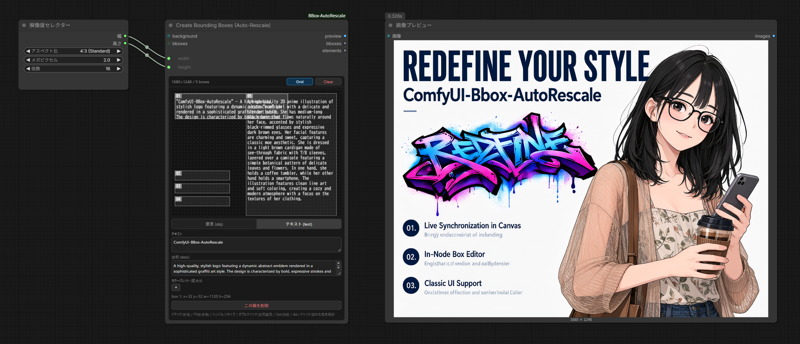

# ComfyUI-BBox-AutoRescale

**Create Bounding Boxes (Auto-Rescale)** は、コアの「Create Bounding Boxes」ノードの
そのまま差し替え可能な代替ノードです。接続された `width` / `height` 入力の実サイズに
キャンバスが自動で追随し、ボックス編集はすべてノード内で完結します。

**Comfy Registry** に `comfyui-bbox-autorescale` として公開されているため、
**ComfyUI Manager** からそのまま導入できます。

> 非公式のコミュニティプロジェクトです。Comfy Org公式とは提携・公認関係にありません。

**Languages:** [English](README.md) · [日本語](README.ja.md)

---

  

## このノードができること

- **自動リサイズキャンバス** — 接続先のサイズが変わったその瞬間にキャンバスも
  リサイズされます（実行不要）。即追従対応ソース: `ResolutionSelector`、
  `PrimitiveInt`、`SeedNode`、`CustomCombo`、`ColorToRGBInt`。それ以外のINTソースも
  初回実行後に追従します。ボックスは実行時に常に正しく比例リスケールされるため、
  保存済みのボックスがズレることはありません。
- **ノード内ボックスエディター** — 空欄ドラッグで新規作成、内側ドラッグで移動、
  8方向リサイズハンドル、ダブルクリックで説明のインライン編集、`Del`で削除、
  `Alt+クリック`で重なって隠れたボックスを選択。
- **obj / text タブ** — 物体ボックスとテキストボックスを切り替え、ボックスごとに
  type / text / description を編集できます。
- **カラーパレット** — ボックスごとの色指定、`+`ボタンでの色追加、グリッドスナップ対応。
- **ノード高さの自動追従** — どの幅にリサイズしても、キャンバスと全コントロールが
  常にぴったり収まります。最小サイズでも要素が隠れません。
- **保存の忠実性** — ワークフローのタブ切り替えやComfyUI起動時も、保存した
  ノードサイズがそのまま復元されます。
- クラシックUI（非フロントエンド）でも動作します。

ウィジェットと出力（preview / bboxes / elements）はコアノードと同一なので、
既存のワークフローはそのまま動作します。

## キャンバスのライブ同期

各入力は接続されたリンクにだけ従います。未接続の幅・高さはそれぞれのウィジェット値を
維持するので、「幅は固定・高さだけセレクター駆動」といった混合構成も使えます。

対応していないINTソースでも、初回実行後にキャンバスが実サイズへ追従します
（ボックスはいずれの場合も実行時に正しくリスケールされます）。

## インストール

**ComfyUI Manager:** `ComfyUI-BBox-AutoRescale` または `comfyui-bbox-autorescale`
で検索してそのまま導入。

**手動インストール:** `ComfyUI-BBox-AutoRescale` フォルダを `ComfyUI/custom_nodes/`
にコピーしてComfyUIを再起動してください。Python依存パッケージは不要です
（ComfyUIコアのみで動作）。最近のComfyUIバージョンでは `.zip` をそのまま
`custom_nodes/` にドロップもできます。

再起動後、ノードパレットで
「Create Bounding Boxes (Auto-Rescale)」を検索してください。

## 注意事項

- `draw_width` / `draw_height` は内部パラメータ（ボックスを描いたサイズを記録する
  ためのもの）です。手動で編集しないでください。
- コアの Bounding Boxes ノード（`comfy_extras/nodes_bounding_boxes.py`）を
  含むComfyUIバージョンが必要です。

## ライセンス

MIT License。`LICENSE` を参照してください。
